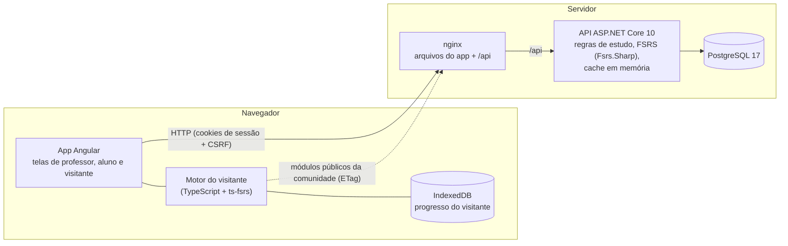

# PERE — Plataforma Educacional de Repetição Espaçada

O PERE ajuda alunos a **lembrar de verdade** o que estudam. Professores montam módulos de conceitos e turmas;
alunos estudam em sessões curtas de até 10 atividades, escolhidas automaticamente, que combinam
**recuperação ativa** (responder em vez de reler) com **repetição espaçada** (revisar no momento certo, antes
de esquecer). Quem não está em turma pode estudar no **modo visitante**, sem conta.

> Projeto de portfólio. Backend em ASP.NET Core 10 + PostgreSQL; frontend em Angular 22 + Tailwind CSS v4.

## Sumário

- [Como funciona](#como-funciona)
- [Comece aqui](#comece-aqui)
- [Pré-requisitos](#pré-requisitos)
- [Ambiente local passo a passo](#ambiente-local-passo-a-passo)
- [Comandos do dia a dia](#comandos-do-dia-a-dia)
- [Contas de demonstração](#contas-de-demonstração)
- [Solução de problemas](#solução-de-problemas)
- [Estrutura de pastas](#estrutura-de-pastas)
- [Capturas de tela](#capturas-de-tela)
- [Publicação (futuro)](#publicação-futuro)

## Como funciona

### Perfis

| Perfil | O que faz | Onde fica o progresso |
|---|---|---|
| **Professor** | Cria módulos (conceitos, atividades, pré-requisitos), publica, importa e exporta em JSON, cria turmas, aprova alunos, acompanha gráficos e compartilha módulos na comunidade. | — |
| **Aluno de turma** | Cria conta (e-mail e senha), pede para entrar numa turma pelo código, estuda depois que o professor aprova. | No banco de dados |
| **Visitante** | Com ou sem conta, estuda módulos da comunidade ou arquivos de módulo em `/visitor`. | Só no navegador (IndexedDB), com exportação e importação de um arquivo de progresso |

### O caminho de cada conceito

Cada conceito de um módulo passa por estados. Uma resposta certa avança; um erro volta um passo.

```text
Novo → Exposição → Reconhecimento → Recordação guiada → Recordação livre → Dominado
```

| Estado | O que o aluno faz | Minigame |
|---|---|---|
| Exposição | Lê a definição e revela as palavras-chave | Exposição |
| Reconhecimento | Reconhece se uma frase está certa ou põe passos em ordem | Verdadeiro/Falso, Ordenação |
| Recordação guiada | Completa uma frase escolhendo as palavras certas | Lacunas, Ordenação |
| Recordação livre e Dominado | Descobre o conceito a partir de pistas e escreve o nome | Adivinhe o conceito |

- **Pré-requisitos**: um conceito novo só aparece quando todos os seus pré-requisitos estão dominados.
- **Domínio**: exige dois acertos em recordação livre, o segundo numa outra sessão e só depois de chegar a
  data da revisão. Errar um conceito dominado o devolve para a recordação livre.
- **Sessão**: até 10 atividades. A ordem de prioridade é: revisões vencidas, conceitos errados nos últimos
  14 dias, conceitos em andamento e, por fim, conceitos novos.
- **Repetição espaçada (FSRS)**: cada resposta vira uma nota (errou → "de novo"; usou 2 ou mais pistas →
  "difícil"; respondeu em até 5 segundos sem pistas → "fácil"; senão → "bom"). O algoritmo FSRS-6 usa essa
  nota para marcar a próxima revisão: conceitos bem lembrados voltam cada vez mais tarde.
- **Prática livre**: treina qualquer conceito sem mexer no progresso oficial.
- **Cruzadinha**: opcional por módulo, montada no navegador com as palavras dos conceitos dominados (ou de
  todos, se o professor permitir).

O backend é a autoridade para alunos de turma: ele escolhe a atividade, corrige a resposta e agenda a revisão.
No modo visitante, um motor em TypeScript segue as mesmas regras no navegador (veja
[frontend/README.md](frontend/README.md) para as pequenas diferenças entre as bibliotecas FSRS).

### Arquitetura



No ambiente de desenvolvimento, o papel do nginx é feito pelo `npm start` (proxy de `/api` para a API).

## Comece aqui

Escolha o seu caminho:

### 1. Só quero ver rodando (precisa apenas do Docker)

```bash
git clone <URL-do-repositório> pere
cd pere
docker compose up -d --build
```

Abra **http://localhost:8080** e entre com uma das [contas de demonstração](#contas-de-demonstração). Na
primeira vez, o build das imagens leva alguns minutos. Para parar: `docker compose down`.

Esse comando sobe o banco, a API (que cria as tabelas e os dados de demonstração sozinha) e o frontend
servido pelo nginx.

### 2. Vou desenvolver

Instale os [pré-requisitos](#pré-requisitos) e siga o [ambiente local passo a passo](#ambiente-local-passo-a-passo).

### 3. Já tenho tudo instalado

Na raiz do repositório, com dois terminais:

```bash
# Terminal 1: banco, tabelas e API (http://localhost:5080)
docker compose up -d postgres
dotnet ef database update --project backend/StudyPlatform.Api/StudyPlatform.Api.csproj --startup-project backend/StudyPlatform.Api/StudyPlatform.Api.csproj
dotnet run --project backend/StudyPlatform.Api/StudyPlatform.Api.csproj

# Terminal 2: frontend (http://localhost:4200)
cd frontend
npm install
npm start
```

## Pré-requisitos

| Ferramenta | Versão | Para quê |
|---|---|---|
| Git | qualquer recente | baixar o código |
| Docker Desktop (ou Docker Engine com Compose) | recente | PostgreSQL local e o "só quero ver rodando" |
| .NET SDK | 10 | API e testes do backend |
| Node.js | ^22.22.3, ^24.15.0 ou >= 26 (exigência do Angular 22) | frontend |
| dotnet-ef | 10.0.0 | aplicar e criar migrations |

### Windows

Com o `winget` (já vem no Windows 10/11), em um PowerShell:

```powershell
winget install --id Git.Git -e
winget install --id Docker.DockerDesktop -e
winget install --id Microsoft.DotNet.SDK.10 -e
winget install --id OpenJS.NodeJS.LTS -e
```

Depois abra o Docker Desktop uma vez (ele precisa estar aberto para os comandos `docker` funcionarem).

### macOS

Com o [Homebrew](https://brew.sh):

```bash
brew install git node@24
brew install --cask docker dotnet-sdk
```

Abra o Docker Desktop uma vez depois de instalar.

### Linux (Ubuntu/Debian)

```bash
sudo apt update && sudo apt install -y git
# Docker Engine + Compose: siga https://docs.docker.com/engine/install/ubuntu/
# .NET SDK 10: siga https://learn.microsoft.com/dotnet/core/install/linux
# Node.js 24 com o nvm (https://github.com/nvm-sh/nvm):
nvm install 24
```

### Em todos os sistemas

```bash
dotnet tool install --global dotnet-ef --version 10.0.0
```

Confira as versões:

```bash
git --version
docker --version
docker compose version
dotnet --version        # 10.x
dotnet ef --version     # 10.0.x
node --version          # v22.22.3+, v24.15.0+ ou v26+
```

## Ambiente local passo a passo

Execute na raiz do repositório.

1. **Subir o banco** (PostgreSQL na porta 5432):
   ```bash
   docker compose up -d postgres
   ```
2. **Criar as tabelas** (a API não aplica migrations sozinha no ambiente local):
   ```bash
   dotnet ef database update --project backend/StudyPlatform.Api/StudyPlatform.Api.csproj --startup-project backend/StudyPlatform.Api/StudyPlatform.Api.csproj
   ```
3. **Rodar a API** em http://localhost:5080 (deixe o terminal aberto):
   ```bash
   dotnet run --project backend/StudyPlatform.Api/StudyPlatform.Api.csproj
   ```
   Para criar também as contas de demonstração, ligue o seed nesse comando:
   ```bash
   # bash/zsh
   PERE_SEED_DEMO=true dotnet run --project backend/StudyPlatform.Api/StudyPlatform.Api.csproj
   # PowerShell
   $env:PERE_SEED_DEMO="true"; dotnet run --project backend/StudyPlatform.Api/StudyPlatform.Api.csproj
   ```
4. **Rodar o frontend** em http://localhost:4200, em outro terminal:
   ```bash
   cd frontend
   npm install
   npm start
   ```
   O `npm start` encaminha `/api` para a API, então app e API ficam na mesma origem e os cookies funcionam.
5. Abra http://localhost:4200 e crie uma conta (ou use as de demonstração, se ligou o seed).

### Variáveis de ambiente da API

Todas desligadas por padrão:

| Variável | Efeito |
|---|---|
| `PERE_APPLY_MIGRATIONS=true` | Aplica as migrations ao iniciar a API. |
| `PERE_SEED_DEMO=true` | Cria os dados de demonstração ao iniciar (só uma vez; depois é ignorado). |
| `PERE_ALLOW_INSECURE_COOKIES=true` | Permite cookies de sessão sem HTTPS fora do ambiente de desenvolvimento. Usado só pelo `docker compose` local; nunca use numa publicação. |

## Comandos do dia a dia

| Comando (na raiz, salvo indicação) | O que faz |
|---|---|
| `docker compose up -d postgres` | Sobe só o banco, para desenvolver. |
| `docker compose stop postgres` | Para o banco (os dados ficam guardados). |
| `docker compose up -d --build` | Sobe tudo (banco, API e frontend) em http://localhost:8080. |
| `docker compose down` | Para e remove os contêineres (os dados ficam guardados). |
| `docker compose down -v` | Para tudo e **apaga o banco** (reset completo). |
| `dotnet ef database update --project backend/StudyPlatform.Api/StudyPlatform.Api.csproj --startup-project backend/StudyPlatform.Api/StudyPlatform.Api.csproj` | Cria ou atualiza as tabelas do banco. |
| `dotnet ef migrations add NomeDaMudanca --project backend/StudyPlatform.Api/StudyPlatform.Api.csproj --startup-project backend/StudyPlatform.Api/StudyPlatform.Api.csproj` | Cria uma migration depois de mudar o modelo de dados. |
| `dotnet ef migrations remove --project backend/StudyPlatform.Api/StudyPlatform.Api.csproj --startup-project backend/StudyPlatform.Api/StudyPlatform.Api.csproj` | Desfaz a última migration ainda não aplicada. |
| `dotnet run --project backend/StudyPlatform.Api/StudyPlatform.Api.csproj` | Roda a API em http://localhost:5080. |
| `dotnet test backend/Tests/StudyPlatform.Tests/StudyPlatform.Tests.csproj` | Roda os testes do motor de aprendizagem (não precisa de banco). |
| `dotnet format backend/StudyPlatform.Api/StudyPlatform.Api.csproj` | Formata o código do backend. |
| `cd frontend` e `npm start` | Roda o frontend em http://localhost:4200. |
| `cd frontend` e `npm test` | Roda os testes do motor do visitante. |
| `cd frontend` e `npm run lint` | Confere o código do frontend (ESLint). |
| `cd frontend` e `npm run format` | Formata o frontend (Prettier). |
| `cd frontend` e `npm run build` | Gera o build de produção em `frontend/dist/pere/browser`. |

Pare a API (Ctrl+C no terminal dela) antes de criar ou remover migrations: com a API rodando, o build que esses
comandos fazem não consegue sobrescrever os arquivos em uso.

**Resetar o banco do ambiente local** (os dados locais são de teste):

```bash
docker compose down -v
docker compose up -d postgres
dotnet ef database update --project backend/StudyPlatform.Api/StudyPlatform.Api.csproj --startup-project backend/StudyPlatform.Api/StudyPlatform.Api.csproj
```

## Contas de demonstração

> **Somente demonstração.** Estas senhas são públicas. Os dados são criados quando a API inicia com
> `PERE_SEED_DEMO=true` (o `docker compose up` completo já faz isso).

| Perfil | E-mail | Senha |
|---|---|---|
| Professor | `professor@pere.demo` | `demo1234` |
| Aluno (já aprovado na turma) | `aluno@pere.demo` | `demo1234` |

- Turma: **Turma de demonstração**, código `DEMO-PERE`.
- Módulo: **Fundamentos de redes**, com 8 conceitos e pré-requisitos (rede → protocolo → IP → TCP/UDP/roteador
  → DNS → HTTP), publicado na turma e compartilhado na comunidade (aparece também no modo visitante).
- O arquivo do módulo está em [backend/StudyPlatform.Api/Seed/demo-module.json](backend/StudyPlatform.Api/Seed/demo-module.json)
  e serve de exemplo do formato de importação. Um exemplo mínimo está em
  [docs/module-exchange-v1.example.json](docs/module-exchange-v1.example.json).

## Solução de problemas

| Sintoma | Causa e solução |
|---|---|
| `failed to connect to the docker API` ou `Cannot connect to the Docker daemon` | O Docker Desktop está fechado. Abra-o e espere ficar "running". |
| `port is already allocated` ou `address already in use` (5432, 5080, 4200 ou 8080) | Outro programa usa a porta. Descubra qual: Windows `netstat -ano \| findstr :5432`; macOS/Linux `lsof -i :5432`. Feche-o ou pare o outro PostgreSQL. |
| Erros 500 e no log da API `Failed to connect to 127.0.0.1:5432` | O banco não está rodando: `docker compose up -d postgres`. |
| `relation "..." does not exist` no log da API | As tabelas não foram criadas: rode o `dotnet ef database update`. |
| `dotnet ef migrations ...` falha com "Build failed" ou "being used by another process" | A API está rodando e trava os arquivos do build. Pare a API (Ctrl+C) e repita o comando. |
| `dotnet ef` não é reconhecido | Instale a ferramenta (`dotnet tool install --global dotnet-ef --version 10.0.0`) e abra um terminal novo. |
| `npm` avisa `EBADENGINE` ou o `ng` reclama da versão do Node | Use Node ^22.22.3, ^24.15.0 ou 26+ (`node --version`). |
| "Sua sessão expirou" ou erro de CSRF logo depois de reiniciar a API | Normal no ambiente local: a API em desenvolvimento cria chaves novas a cada início. Entre de novo. Se persistir, apague os cookies de `localhost`. |
| Banco criado por uma versão antiga do projeto dá erros de coluna ou tabela | Recrie: `docker compose down -v` e depois os passos 1 e 2 do ambiente local. |
| Na primeira subida do compose, o log da API mostra `Failed executing DbCommand ... __EFMigrationsHistory` | Normal: com o banco vazio, o EF procura o histórico de migrations antes de criá-lo. As linhas seguintes aplicam as migrations. |
| O modo visitante "perdeu" o progresso | O progresso do visitante fica no navegador: limpar os dados do site ou usar outra janela anônima apaga tudo. Use "Exportar progresso" para guardar uma cópia. |

## Estrutura de pastas

```text
.
├── backend/
│   ├── StudyPlatform.Api/         API ASP.NET Core 10
│   │   ├── Controllers/           rotas HTTP (auth, módulos, turmas, aluno, comunidade, públicas)
│   │   ├── Services/              regras: Learning (motor e FSRS), Modules, Classrooms, Auth, Progress
│   │   ├── Models/, Data/         entidades e configuração do EF Core
│   │   ├── Migrations/            migration única Initial
│   │   ├── Seed/                  dados de demonstração
│   │   └── Dockerfile
│   └── Tests/StudyPlatform.Tests/ testes unitários do motor (xUnit)
├── frontend/                      app Angular 22
│   ├── src/app/core/              serviços da API, autenticação, CSRF, tema
│   ├── src/app/pages/             telas de login, aluno e professor
│   ├── src/app/minigames/         os 5 minigames e a cruzadinha
│   ├── src/app/visitor/           modo visitante (motor em engine/, IndexedDB)
│   ├── src/app/shared/            componentes comuns e gráficos
│   ├── Dockerfile, nginx.conf     imagem de produção (nginx)
│   └── README.md                  detalhes do frontend e do motor do visitante
├── docs/                          exemplo do formato de módulo (schemaVersion 1)
├── docker-compose.yml             banco (desenvolvimento) ou tudo (demonstração)
├── vercel.json                    publicação futura
└── .github/workflows/ci.yml       CI: build, formatação e testes
```

## Capturas de tela

<!-- Adicione as imagens em docs/screenshots/ e troque os marcadores abaixo. -->

- Tela de entrada: _(em breve)_
- Área do aluno e sessão de estudo: _(em breve)_
- Dashboard do professor: _(em breve)_
- Modo visitante: _(em breve)_

## Publicação (futuro)

A publicação ainda não está configurada. Há um `vercel.json` e Dockerfiles prontos para uma publicação futura
(frontend e API no Vercel, banco no Neon). O plano gratuito do Neon limita a transferência de rede por mês, por
isso a API guarda em memória o conteúdo dos módulos e os dados públicos da comunidade, para ler o banco o mínimo
possível.
