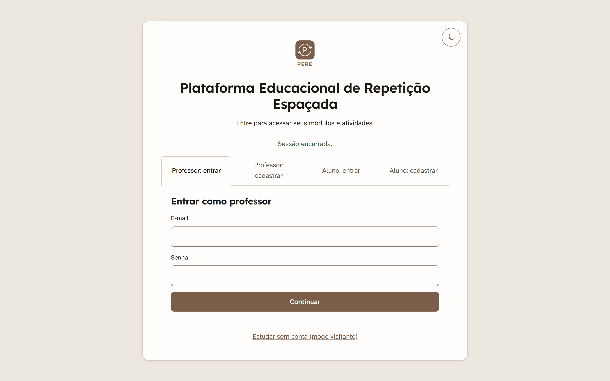
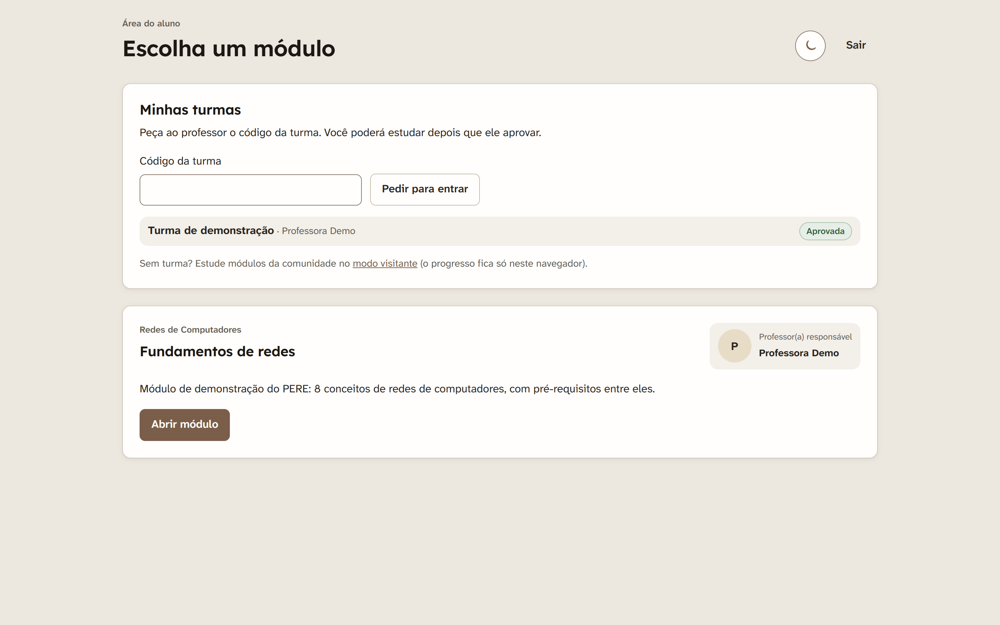
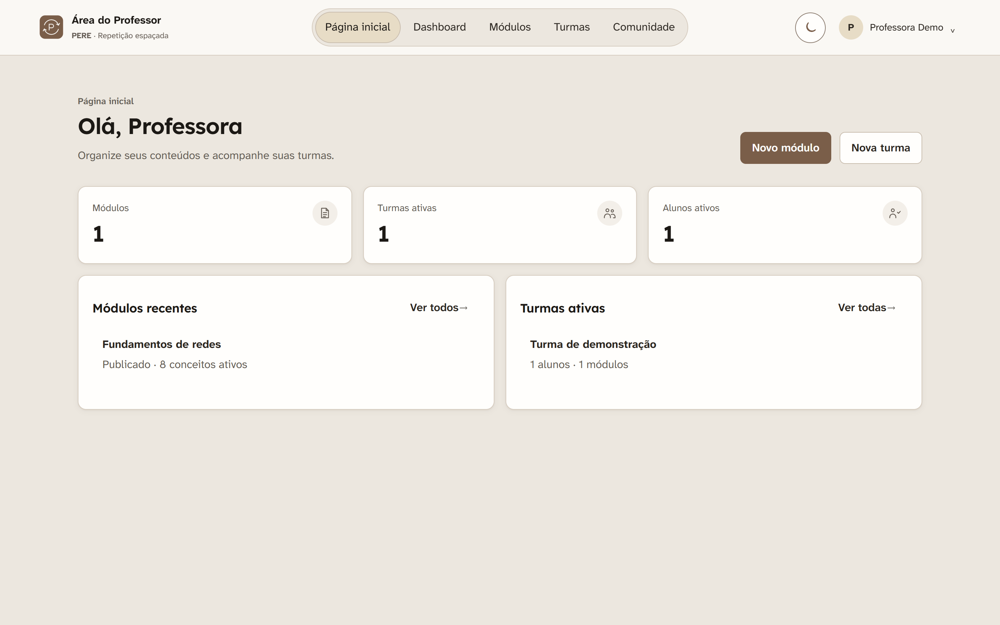
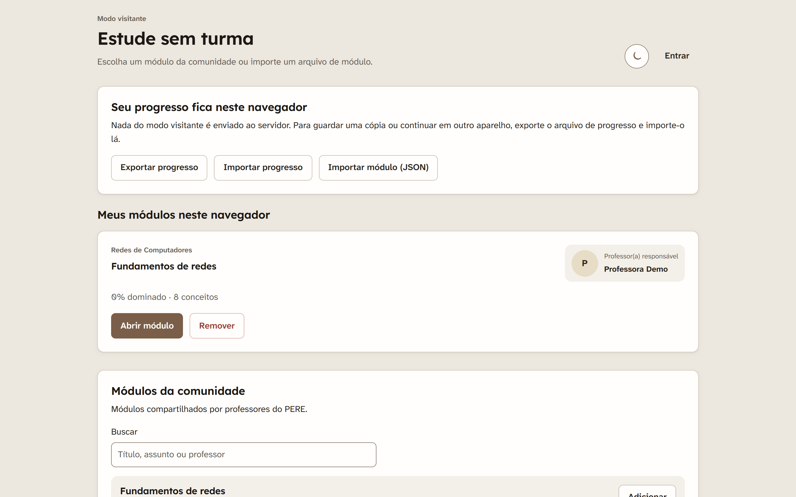
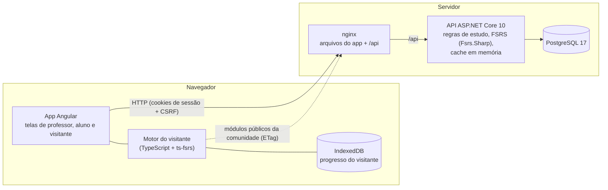

# PERE — Plataforma Educacional de Repetição Espaçada

O PERE ajuda alunos a **lembrar de verdade** o que estudam. Professores montam módulos de conceitos e turmas;
alunos estudam em sessões curtas de até 10 atividades, escolhidas automaticamente, que combinam
**recuperação ativa** (responder em vez de reler) com **repetição espaçada** (revisar no momento certo, antes
de esquecer). Quem não está em turma estuda no **modo visitante**, sem conta.

[](https://github.com/Brenovnc/PERE/actions/workflows/ci.yml)

## 🌐 Acesse: https://pere-estudos.vercel.app

| Tela inicial | Sessão de estudo do aluno |
|---|---|
|  |  |
| **Painel do professor** | **Modo visitante** |
|  |  |

## Sumário

- [Destaques técnicos](#destaques-técnicos)
- [Stack](#stack)
- [Decisões técnicas](#decisões-técnicas)
  - [Design e usabilidade](#design-e-usabilidade)
- [História do projeto](#história-do-projeto)
- [Como usei IA](#como-usei-ia)
- [Como funciona](#como-funciona)
- [Como rodar](#como-rodar)
- [Estrutura de pastas](#estrutura-de-pastas)
- [Publicação](#publicação)
- [Licença](#licença)
- [Autor](#autor)

## Destaques técnicos

- **Desempenho no backend:** cada resposta de aluno fazia de **41 a 52 consultas SQL** e agora faz **7** (medido
  antes e depois). Três mudanças explicam isso: cache em memória do conteúdo dos módulos, com invalidação quando
  o professor edita; fim da consulta ao banco a cada requisição para validar o cookie de sessão (o cookie leva só
  claims); e correção de consultas N+1.
- **Autenticação por cookie** (HttpOnly, 8 horas) com **proteção CSRF** por token validado em um middleware.
- **Limite de tentativas** em login, cadastro e entrada em turma (10 por minuto).
- **FSRS-6 no backend e no navegador:** o backend agenda as revisões dos alunos de turma; o **modo visitante**
  roda o mesmo motor no navegador, **sem banco**, guardando o progresso em IndexedDB, com **exportar e importar
  progresso**.
- **Endpoints públicos com cache e ETag** para a comunidade de módulos.
- **Docker com um comando:** `docker compose up -d --build` sobe banco, API e frontend, já com dados de demonstração.
- **CI** no GitHub Actions: build, formatação, testes do motor, lint e build do frontend.

## Stack

- **Backend:** ASP.NET Core 10, EF Core 10 + Npgsql, PostgreSQL 17, Fsrs.Sharp (FSRS-6), xUnit.
- **Frontend:** Angular 22 (standalone, signals, zoneless, rotas lazy, TypeScript estrito), Tailwind CSS v4,
  Angular CDK, ts-fsrs, ESLint + Prettier, Vitest.
- **Infraestrutura:** Docker Compose, nginx, GitHub Actions.

## Decisões técnicas

- **Cookie em vez de JWT:** o app e a API ficam na mesma origem, então um cookie HttpOnly é mais simples e mais
  seguro (o JavaScript não lê o cookie) do que guardar um token no navegador. O custo é a proteção CSRF, que
  está implementada.
- **Cache em memória:** o plano gratuito do Neon limita a transferência de rede (5 GB por mês), então a API evita
  ler o banco à toa: guarda o conteúdo dos módulos e os dados públicos da comunidade em memória.
- **Progresso do visitante no navegador:** visitantes não precisam de conta nem de banco. O progresso fica em
  IndexedDB e pode ser exportado e importado como arquivo.
- **Backend como autoridade para alunos de turma:** o servidor escolhe a atividade, corrige a resposta e agenda a
  revisão. O aluno não consegue forjar o próprio progresso.
- **Angular + Tailwind:** Angular moderno (signals, sem zone.js, controle de fluxo novo) para um código enxuto, e
  Tailwind v4 com tokens de tema em CSS para claro e escuro.

### Design e usabilidade

Na revisão visual, estas foram as decisões (as regras ficam documentadas na seção "Guia visual" do
[CLAUDE.md](CLAUDE.md)):

- **Tipografia:** Lexend nos títulos e enunciados das atividades (família criada para facilitar a leitura) e
  Atkinson Hyperlegible Next no texto e na interface (criada pelo Braille Institute para legibilidade). Não há
  fonte serifada.
- **Cores:** paleta derivada das cores da logo (bege, marrom, marfim), com neutros puxados para o mesmo tom
  quente, um ardósia (complementar do marrom) só para seleção nos jogos e cores de estado (verde, vermelho,
  ocre). O contraste foi conferido (texto ≥ 4,5:1; bordas e gráficos ≥ 3:1) nos temas claro e escuro.
- **Hierarquia:** uma ação principal por área, ações destrutivas nunca em destaque, o enunciado da atividade
  como texto mais importante da tela e instruções longas em ajuda contextual (botão "?").
- **Heurísticas de Nielsen** usadas na revisão: visibilidade do estado do sistema (barra de progresso
  "Atividade N de 10"), consistência (nomes e componentes iguais em todas as telas), design minimalista
  (menos texto e menos caixas) e prevenção de erros (ações de perigo diferenciadas).
- **Select com melhoria progressiva:** `appearance: base-select` onde o navegador suporta; nos outros, o
  select nativo estilizado.

## História do projeto

O PERE começou como um trabalho acadêmico, com frontend em React e backend em ASP.NET Core. Depois eu o
reestruturei em 7 fases:

1. desempenho (cache e menos consultas);
2. enxugamento do backend;
3. conta de aluno e matrícula em turma;
4. frontend refeito em Angular 22;
5. modo visitante;
6. acabamento;
7. revisão visual e de usabilidade (tipografia, cores, hierarquia e minigames).

A tag `antes-da-reestruturacao` do Git marca o estado original do projeto.

## Como usei IA

A reestruturação foi feita com o Claude Code, a partir de um plano em fases que eu mesmo escrevi. Trabalhei uma
fase por vez: pedia, o Claude Code executava e eu conferia as medições, lia os relatórios, testava à mão e pedia
as correções que faltavam. As regras de trabalho (o que ele pode ou não fazer, o estilo do código, o que está
fora de escopo) ficam no arquivo [CLAUDE.md](CLAUDE.md).

A revisão visual também foi feita em fases. Primeiro levantei os problemas usando o próprio sistema; depois
pesquisei referências (heurísticas de Nielsen, Refactoring UI, Laws of UX, WCAG) com apoio do Claude e escrevi
os prompts. O Claude Code executou fase por fase, e eu conferi no navegador e pedi os ajustes finos.

## Como funciona

### Perfis

| Perfil | O que faz | Onde fica o progresso |
|---|---|---|
| **Professor** | Cria módulos (conceitos, atividades, pré-requisitos), publica, importa e exporta em JSON, cria turmas, aprova alunos, acompanha gráficos e compartilha módulos na comunidade. | — |
| **Aluno de turma** | Cria conta (e-mail e senha), pede para entrar numa turma pelo código, estuda depois que o professor aprova. | No banco de dados |
| **Visitante** | Com ou sem conta, estuda módulos da comunidade ou arquivos de módulo em `/visitor`. | Só no navegador (IndexedDB), com exportação e importação de um arquivo de progresso |

### O caminho de cada conceito

Cada conceito de um módulo passa por estados. Uma resposta certa avança; um erro volta um passo.

```text
Novo → Exposição → Reconhecimento → Recordação guiada → Recordação livre → Dominado
```

| Estado | O que o aluno faz | Minigame |
|---|---|---|
| Exposição | Lê a definição e revela as palavras-chave | Leitura |
| Reconhecimento | Reconhece se uma frase está certa ou põe passos em ordem | Verdadeiro ou falso, Ordenação |
| Recordação guiada | Completa uma frase escolhendo as palavras certas: tocar numa palavra a coloca na próxima lacuna vazia (ou na lacuna escolhida); também dá para arrastar | Complete as lacunas, Ordenação |
| Recordação livre e Dominado | Descobre o conceito a partir de pistas e escreve o nome | Qual é o conceito? |

- **Pré-requisitos**: um conceito novo só aparece quando todos os seus pré-requisitos estão dominados.
- **Domínio**: exige dois acertos em recordação livre, o segundo numa outra sessão e só depois de chegar a
  data da revisão. Errar um conceito dominado o devolve para a recordação livre.
- **Sessão**: até 10 atividades. A ordem de prioridade é: revisões vencidas, conceitos errados nos últimos
  14 dias, conceitos em andamento e, por fim, conceitos novos.
- **Repetição espaçada (FSRS)**: cada resposta vira uma nota (errou → "de novo"; usou 2 ou mais pistas →
  "difícil"; respondeu em até 5 segundos sem pistas → "fácil"; senão → "bom"). O algoritmo FSRS-6 usa essa
  nota para marcar a próxima revisão: conceitos bem lembrados voltam cada vez mais tarde.
- **Prática livre**: treina qualquer conceito sem mexer no progresso oficial.
- **Cruzadinha**: opcional por módulo, montada no navegador com as palavras dos conceitos dominados (ou de
  todos, se o professor permitir).

O backend é a autoridade para alunos de turma: ele escolhe a atividade, corrige a resposta e agenda a revisão.
No modo visitante, um motor em TypeScript segue as mesmas regras no navegador (veja
[frontend/README.md](frontend/README.md) para as pequenas diferenças entre as bibliotecas FSRS).

### Arquitetura



No ambiente de desenvolvimento, o papel do nginx é feito pelo `npm start` (proxy de `/api` para a API).

## Como rodar

### Só quero ver rodando (precisa apenas do Docker)

```bash
git clone https://github.com/Brenovnc/PERE.git
cd PERE
docker compose up -d --build
```

Abra **http://localhost:8080** e entre com uma das [contas de demonstração](#contas-de-demonstração). Na
primeira vez, o build das imagens leva alguns minutos. Para parar: `docker compose down`.

Esse comando sobe o banco, a API (que cria as tabelas e os dados de demonstração sozinha) e o frontend
servido pelo nginx.

### Vou desenvolver

Com .NET SDK 10, Node.js, Docker e a ferramenta `dotnet-ef` instalados, na raiz do repositório e com dois
terminais:

```bash
# Terminal 1: banco, tabelas e API (http://localhost:5080)
docker compose up -d postgres
dotnet ef database update --project backend/StudyPlatform.Api/StudyPlatform.Api.csproj --startup-project backend/StudyPlatform.Api/StudyPlatform.Api.csproj
PERE_SEED_DEMO=true dotnet run --project backend/StudyPlatform.Api/StudyPlatform.Api.csproj   # PowerShell: $env:PERE_SEED_DEMO="true"; dotnet run ...

# Terminal 2: frontend (http://localhost:4200)
cd frontend
npm install
npm start
```

Pré-requisitos por sistema, comandos do dia a dia, variáveis de ambiente e solução de problemas estão em
[docs/DESENVOLVIMENTO.md](docs/DESENVOLVIMENTO.md).

### Contas de demonstração

> **Somente demonstração.** Estas senhas são públicas. Os dados são criados quando a API inicia com
> `PERE_SEED_DEMO=true` (o `docker compose up` completo já faz isso).

| Perfil | E-mail | Senha |
|---|---|---|
| Professor | `professor@pere.demo` | `demo1234` |
| Aluno (já aprovado na turma) | `aluno@pere.demo` | `demo1234` |

- Turma: **Turma de demonstração**, código `DEMO-PERE`.
- Módulo: **Fundamentos de redes**, com 8 conceitos e pré-requisitos (rede → protocolo → IP → TCP/UDP/roteador
  → DNS → HTTP), publicado na turma e compartilhado na comunidade (aparece também no modo visitante).
- O arquivo do módulo está em [backend/StudyPlatform.Api/Seed/demo-module.json](backend/StudyPlatform.Api/Seed/demo-module.json)
  e serve de exemplo do formato de importação. Um exemplo mínimo está em
  [docs/module-exchange-v1.example.json](docs/module-exchange-v1.example.json).

## Estrutura de pastas

```text
.
├── backend/
│   ├── StudyPlatform.Api/         API ASP.NET Core 10
│   │   ├── Controllers/           rotas HTTP (auth, módulos, turmas, aluno, comunidade, públicas)
│   │   ├── Services/              regras: Learning (motor e FSRS), Modules, Classrooms, Auth, Progress
│   │   ├── Models/, Data/         entidades e configuração do EF Core
│   │   ├── Migrations/            migration única Initial
│   │   ├── Seed/                  dados de demonstração
│   │   └── Dockerfile
│   └── Tests/StudyPlatform.Tests/ testes unitários do motor (xUnit)
├── frontend/                      app Angular 22
│   ├── src/app/core/              serviços da API, autenticação, CSRF, tema
│   ├── src/app/pages/             telas de login, aluno e professor
│   ├── src/app/minigames/         os 5 minigames e a cruzadinha
│   ├── src/app/visitor/           modo visitante (motor em engine/, IndexedDB)
│   ├── src/app/shared/            componentes comuns e gráficos
│   ├── Dockerfile, nginx.conf     imagem de produção (nginx)
│   └── README.md                  detalhes do frontend e do motor do visitante
├── docs/                          guia de desenvolvimento, prints e exemplo do formato de módulo
├── docker-compose.yml             banco (desenvolvimento) ou tudo (demonstração)
├── vercel.json                    configuração de publicação (Vercel)
└── .github/workflows/ci.yml       CI: build, formatação e testes
```

## Publicação

O PERE está no ar em **[https://pere-estudos.vercel.app](https://pere-estudos.vercel.app)**.

- **Frontend e API:** Vercel, cada um com seu Dockerfile; o `vercel.json` encaminha `/api` para a API, na mesma origem do app.
- **Banco:** PostgreSQL no Neon (plano gratuito).
- **Contas de demonstração:** as [contas de demonstração](#contas-de-demonstração) funcionam no site publicado.
- **Segurança:** em produção, os cookies de sessão só trafegam por HTTPS. A opção `PERE_ALLOW_INSECURE_COOKIES` existe apenas para o `docker compose` local e não é usada na publicação.
- **Custo de banco:** o plano gratuito do Neon limita a transferência de rede por mês. Por isso a API guarda em memória o conteúdo dos módulos e os dados públicos da comunidade, e os endpoints públicos usam ETag, para ler o banco o mínimo possível. Foi essa limitação que motivou a otimização descrita em [Destaques técnicos](#destaques-técnicos).

## Licença

Distribuído sob a licença MIT. Veja o arquivo [LICENSE](LICENSE).

## Autor

Breno Vieira — LinkedIn: www.linkedin.com/in/breno-carneiro
